# Dr. Rafael Sukiennik · Forever Young

Site institucional para um consultório de **Medicina Estética & Regenerativa**, feito como **tema WordPress sob medida**, sem page builder.

> Este repositório é uma vitrine de portfólio: só telas e documentação.
> O código-fonte do tema, as configurações e os dados do cliente não estão aqui.

**Vitrine interativa:** [tigos88.github.io/rafael-sukiennik-p](https://tigos88.github.io/rafael-sukiennik-p/)

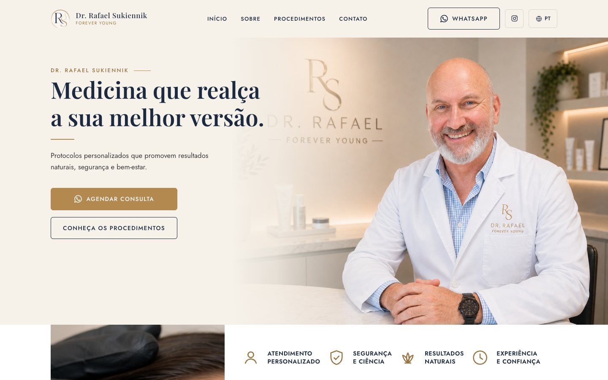

## Destaques

| | |
|---|---|
| **Tema próprio** | PHP, CSS e JavaScript escritos do zero, sem page builder e sem jQuery |
| **3 idiomas** | Português, inglês e hebraico, com o layout espelhado (RTL) |
| **Mobile-first** | Testado em largura real de iPhone (390px), não só nos breakpoints |
| **Design system** | Cores, tipografia, botões e cards definidos como variáveis CSS |
| **SEO técnico** | Meta tags, Open Graph, JSON-LD `schema.org/Physician`, sitemap |
| **Segurança** | Hardening do WordPress: XML-RPC desligado, usuários protegidos, cabeçalhos HTTP |

## Telas

### Desktop · 1440px

| Hero | Sobre |
|---|---|
|  | 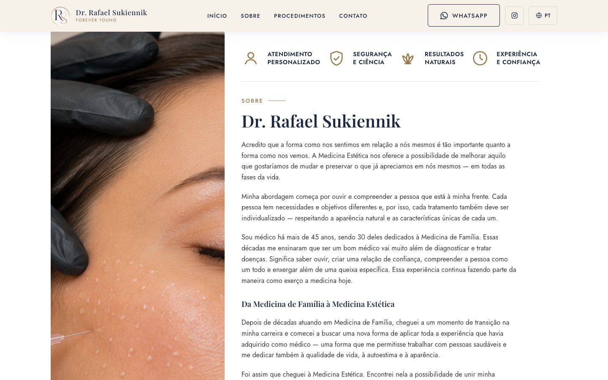 |
| **Procedimentos** | **Agendamento e rodapé** |
| 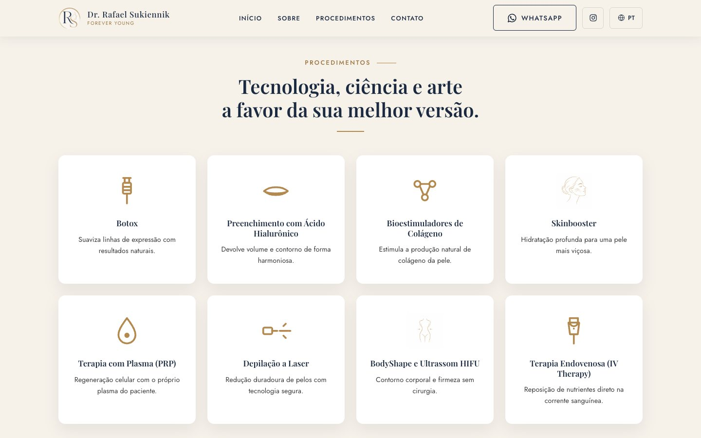 | 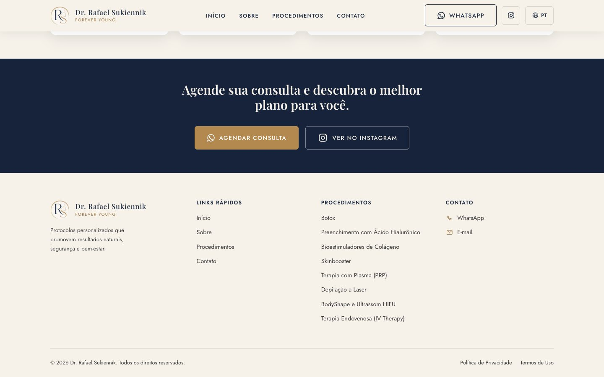 |

### Mobile · 390px

| Hero | Menu | Sobre | Procedimentos |
|---|---|---|---|
| 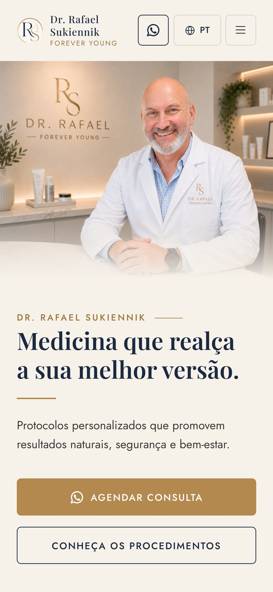 | 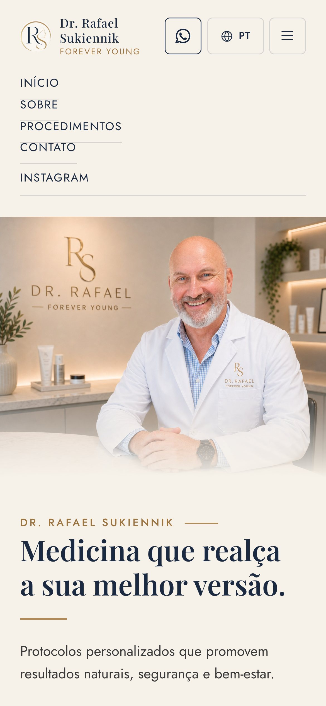 | 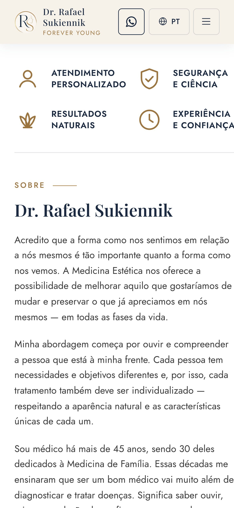 | 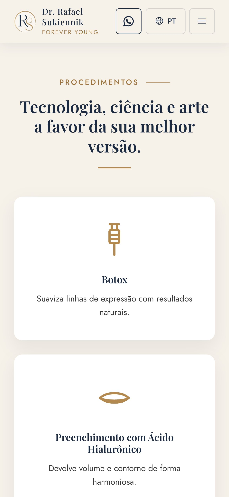 |

### Três idiomas, duas direções

O seletor no cabeçalho troca o idioma. Em hebraico, `dir="rtl"` e as propriedades lógicas de CSS espelham o layout: logo, menu, botões e foto trocam de lado.

| Português | English | עברית (RTL) |
|---|---|---|
|  | 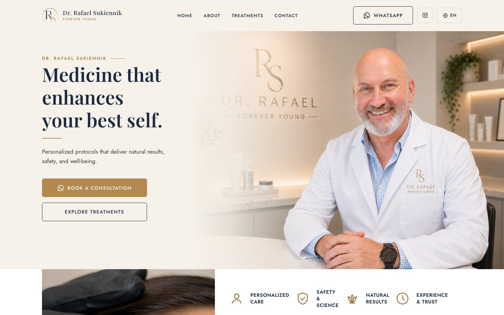 | 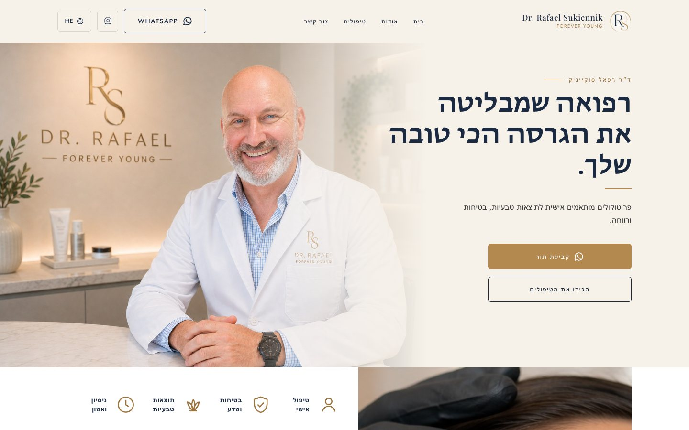 |

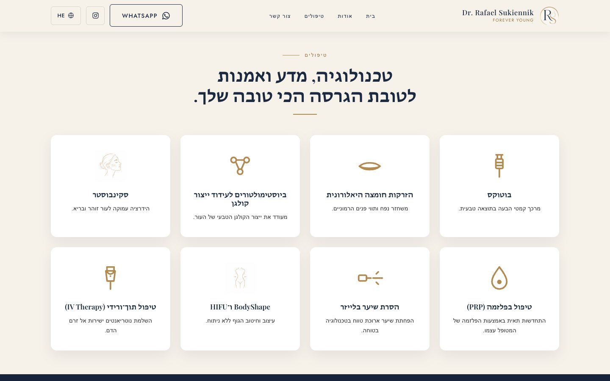

## Design system

| Token | Cor | Uso |
|---|---|---|
| `--color-cream` | `#F6F1E9` | Fundo da página |
| `--color-navy` | `#1B2A41` | Títulos e faixa de chamada |
| `--color-gold` | `#B4894F` | Destaques, ícones e botão principal |
| `--color-gold-dark` | `#9C7440` | Hover do botão principal |
| `--color-body` | `#3A3A3A` | Texto corrido |

- **Tipografia:** Playfair Display nos títulos, Jost no texto, menus e botões.
- **Ícones:** SVG inline de traço fino, que herdam a cor do texto.
- **Movimento:** entrada com fade e deslocamento vertical (600 ms, `cubic-bezier(0.16, 1, 0.3, 1)`), com 80 ms entre cards. Fica desligada com `prefers-reduced-motion`.

## Stack

WordPress · PHP 8.2 · CSS puro · JavaScript sem dependências · Docker (WordPress + MySQL + WP-CLI) para o ambiente local

## Status

- [x] Home completa: cabeçalho fixo, hero, sobre, procedimentos, chamada e rodapé
- [x] Design system e animações de entrada
- [x] Três idiomas com suporte a RTL
- [x] Hardening inicial e SEO técnico
- [ ] Páginas internas: Sobre, Procedimentos, Clínica, Blog e Contato
- [ ] Tipo de post `procedimento` com campos personalizados
- [ ] Formulário de contato
- [ ] Imagens WebP/AVIF, cache e imagem de compartilhamento

---

Desenvolvimento: **Thiago Alves**. Imagens e marca pertencem ao Dr. Rafael Sukiennik e são usadas aqui apenas para fins de portfólio.
